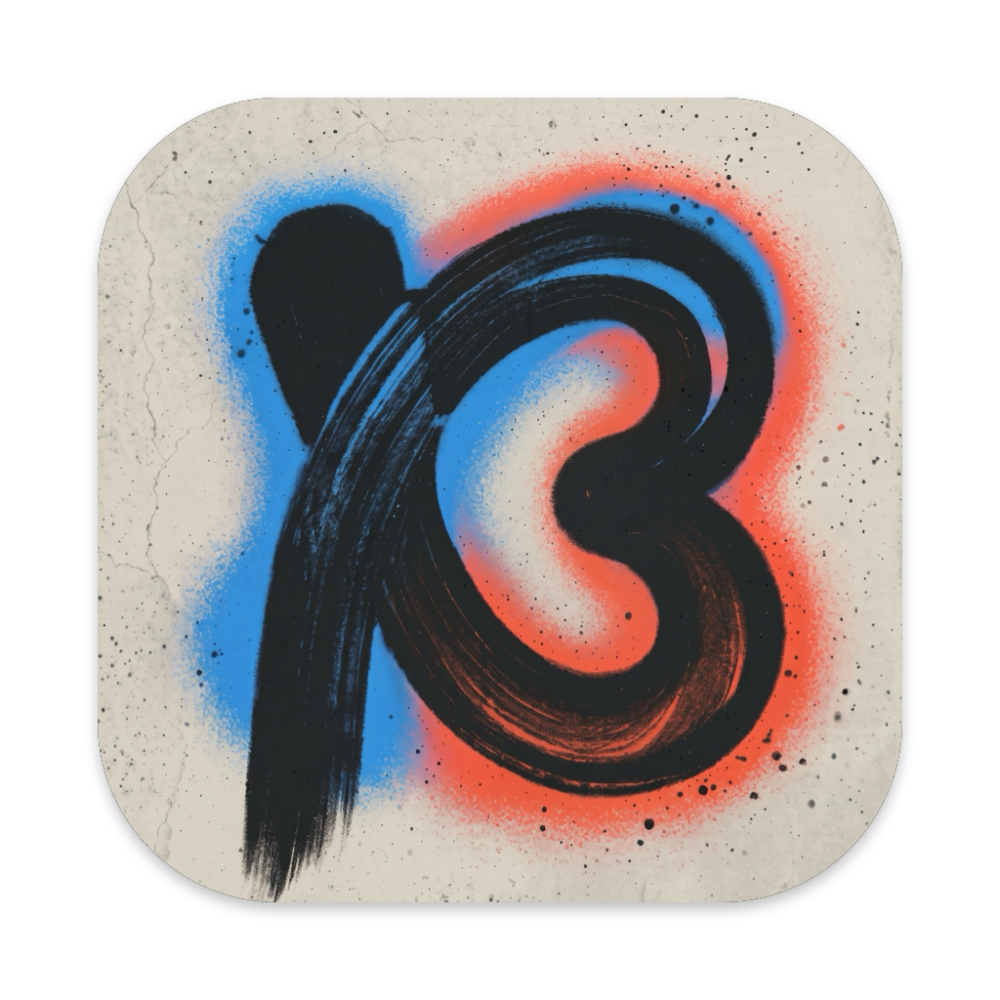

<p align="center">
  
</p>

# Bend

A native macOS browser with vertical tabs, tiled panes, and AI chat.

- [Build and run](lat.md/architecture/build.md#development-signing)
- [Architecture and behavior](lat.md/architecture/architecture.md)
- [AI chat and accounts](lat.md/architecture/ai.md)
- [Settings and extensions](lat.md/architecture/extensions/catalog.md#extension-settings)
- [Per-website settings](lat.md/architecture/settings.md#website-settings)
- [Tests and verification](lat.md/tests/tests.md)
- [Changelog](CHANGELOG.md)
- [Adding changelog entries and preparing releases](lat.md/releases.md)

## Run tests without taking over your desktop

On an Apple Silicon Mac with macOS 14 or newer, use a local Tart VM for a separate test desktop:

```sh
scripts/test-vm.sh                             # provision one guest and run the full suite
scripts/test-vm.sh --jobs 2                    # provision both guests and run the full suite
```

**For coding agents:** prefer `scripts/test-vm.sh` for local Swift tests, including filtered runs.
If the VM is unavailable or in use, ask before falling back to `scripts/test.sh` or `swift test` on the host.

The baseline installs the Command Line Tools once using the newest CLT label offered by
Apple's `softwareupdate` **inside the Tahoe guest**. Each test clone inherits that installation.
Rebuilding the baseline repeats discovery and may pick a newer toolchain.

`scripts/test-vm.sh prefetch` caches Sparkle's pinned SwiftPM release archive. Each test run copies
the checksum-verified archive into its fresh guests before SwiftPM resolves packages.

The first run restores Apple's Tahoe 26.6.2 IPSW (~20 GB, reused if cached), or uses the
existing Bend guest. For a fresh guest, the runner shows the exact host `sudo` command
that mounts its disk and installs the first-boot job. Review it and type `y` to proceed;
pressing Enter cancels. `sudo` may then ask for your host password. The guest
configures a test account, automatic login, SSH, and Apple's Tahoe Command Line Tools.
Once the test desktop is ready, the runner shuts it down and saves it as a clean baseline.
Each run creates one or two local copy-on-write clones from that baseline. Only the clones
receive the working tree and run tests. Preferences and Keychain changes do not carry over.
For full suites and `--filter NAME`, the first worker builds and loads the test bundle once.
Before tests run, the runner atomically saves its `.build` archive under
`~/Library/Caches/Bend/test-vm/swift-build/` and restores a private copy into the other worker.
An identical working tree reuses the finished build; edits within the same baseline and
dependency configuration seed an incremental build. `wipe` can remove this cache separately.
Other SwiftPM arguments use the normal build path. Existing persistent test guests from older versions
are not used as baselines; they can be removed with `wipe`.
No guest window, Apple ID, manual Xcode installation, or separate enrollment is required.
`scripts/test-vm.sh setup` is optional and prepares the baseline without running tests.
If Tart itself is missing, the runner prints install instructions for your package manager.

```sh
scripts/test-vm.sh --filter newWindowKeyboardCommand # smoke-test native windows
scripts/test-vm.sh stop                       # stop any remaining Bend guests
scripts/test-vm.sh wipe                       # choose guests, cached IPSW, and/or logs, then confirm
```

Test runs boot without a viewer, sync tracked and
non-ignored untracked files into a guest working directory, and stream `scripts/test.sh`
output and exit status back to your terminal. Worker disks are discarded after success,
failure, or Ctrl+C; an interrupted cleanup is retried at the next run.
Developers running `scripts/test.sh` directly do not need Tart.

The two-shard run uses two disposable guests (about 16 GiB
of configured guest RAM total). Both receive the same working-tree snapshot. Output is
shown in two live terminal panes with per-shard group progress (labeled lines when piped).
Full logs of the latest run are in `~/Library/Caches/Bend/test-vm/shard-{1,2}.log`.
Each VM test command has an independent host watchdog, including during compilation.
After 60 seconds without output it probes the guest test process and reports its status.
A vanished process with a stuck SSH session, five minutes of silence, or one hour of wall
time fails that worker with status 124. Other shards can finish; the timeout reason and
last phase are recorded in the shard log before the disposable guests are cleaned up.
Either shard failing fails the run. Ctrl+C during the parallel run
or `scripts/test-vm.sh stop` stops both guests. Filtered runs still use one VM.

## AI module

Bend owns its AI runtime in `Sources/AI`, with tests in `Tests/AITests`. See [API examples](docs/ai-sdk.md) and [the AI SDK knowledge graph](lat.md/ai-sdk/ai-sdk.md).
