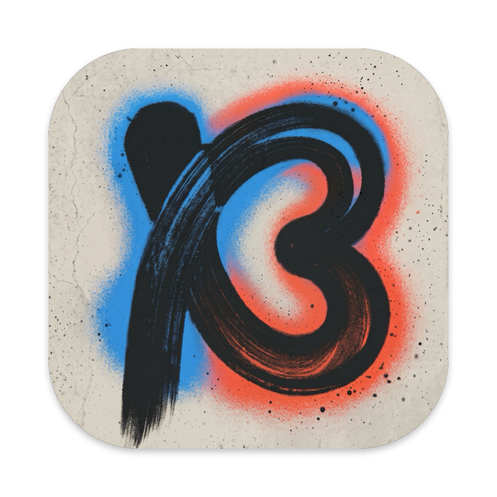

  

# Bend

A native macOS browser with vertical tabs and tiled panes.

- [Build and run](lat.md/architecture/build.md#development-signing)
- [Architecture and behavior](lat.md/architecture/architecture.md)
- [Settings and extensions](lat.md/architecture/extensions/catalog.md#extension-settings)
- [Per-website settings](lat.md/architecture/settings.md#website-settings)
- [Tests and verification](lat.md/tests/tests.md)
- [Changelog](CHANGELOG.md)
- [Adding changelog entries and preparing releases](lat.md/releases.md)
